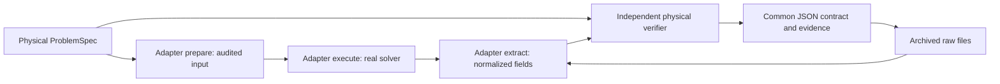

# Architecture and public interfaces

Mission 3 introduces two independent boundaries: a physical problem/verification
boundary and a solver/serialization boundary. CalculiX is the only solver adapter.
No plugin registry, server, UI, workflow engine or LLM dependency is introduced.



## Responsibility map

| Component | Responsibility | Must not do |
|---|---|---|
| `specification.py`, `modal_problem.py`, `thermal_problem.py` | Physical configuration, units, BCs, supported domain | Invoke a solver |
| `interfaces.py` | Small dataclasses and structural Python protocols | Own physics or a plugin framework |
| `adapters/calculix.py` | Generate input, execute, extract, normalize, validate raw output semantics | Fit or evaluate analytical references |
| `model.py`, `thermal_input.py` | CalculiX input serializers/auditors | Claim successful output verification |
| `adapters/modal_dat.py`, `frd.py`, `thermal_output.py` | CalculiX DAT/FRD codecs and cross-file checks | Substitute analytical numbers for missing solver results |
| `reference.py`, `thermal_problem.analytical` | Independent analytical equations | Read FEM output |
| `modal_verification.py`, `thermal_verification.py`, `verification.py` | Check normalized physical quantities, constraints, conservation, mesh studies | Parse solver files or select a solver |
| `results.py`, packaged JSON Schema | Versioned, unit-bearing interoperability contract | Treat schema validity as physical verification |
| `evidence.py`, report modules | Persistence, hashes, provenance, reports | Start user-operated services |
| `runner.py` | Connect the components, CLI, compatibility replay | Embed solver-specific reference physics |
| `benchmark.py` | Preserve Mission 1/2 imports and CLI | Duplicate the implementation |

Existing mathematical checks were moved incrementally without changing the
original 29 tests or modal tolerance values. The existing public imports from
`benchmark`, `model` and `reference` remain available. Q8 transfer math is isolated
in `coupling.py`; the serialized equations remain the CalculiX adapter's responsibility.

## Minimal interfaces

`ProblemSpec` contains `id`, `analysis`, validated `parameters`, explicit `units`,
physical `boundary_conditions`, `required_quantities` and `unsupported_capabilities`.
`load_problem(config)` preserves unversioned Mission 1/2 physical input files;
the new thermal input explicitly declares `spec_version: "1.0"`.

`SolverAdapter` is a Python structural protocol:

1. `prepare(problem, counts) -> PreparedInput`: return relative text input files,
   an audited serialized deck, physical node coordinates/connectivity, canonical
   topology/integration information and explicit auxiliary-node roles. No run yet.
2. `execute(prepared, directory, executable) -> solver_version`: run the real solver
   noninteractively, preserve logs, inspect success/errors and fail on missing output
   or execution errors. A zero process exit is insufficient.
3. `extract(prepared, directory, solver_version) -> normalized_run`: read actual
   files, validate coverage/semantics, and return unit-bearing quantities in physical
   coordinates. Verify relevant logs/version on replay as well. Do not run a solver
   or read analytical references inside extraction.

`PreparedInput` is a frozen dataclass; its mapping payloads are ordinary Python data,
not deeply immutable objects. Input file names must be safe relative leaf names.
The adapter audits its serialized material/BCs against the physical specification.
The runner retains raw files and the audit and compares regenerated input on replay.

`NumericalVerifier.verify(problem, normalized_run)` returns `status`, Boolean
`checks` and numerical `metrics`. `study(runs)` verifies the mesh study. The modal
study retains its frequency-convergence criteria; the slab study is mesh consistency.
No verifier imports the CalculiX adapter or DAT/FRD codecs. Modal compatibility
routines adapt arbitrary external node labels using explicit `point_mass` roles;
the public normalized IDs are not changed.

`run_benchmark(config, output, executable, adapter=None)` accepts an explicit
adapter instance (default CalculiX). `replay(directory, adapter=None)` regenerates
input, re-extracts raw fields, repeats physical checks, validates the schema and
compares the contract with the archived one. No solver or AI runs during replay.
An archive for another adapter requires its matching explicit adapter instance.
The current CLI deliberately exposes only the implemented CalculiX workflow.

## Results contract and evidence

See [results schema](results-schema.md) and the packaged
[`results-v1.json`](../src/open_cae_evidence/schemas/results-v1.json).
`normalized-results.json` is the public, solver-independent contract (1.0.0).
`results.json` is the internal evidence index (archive version 3) with retained
Mission 1/2 fields for compatibility. Each mesh has `solver-results.json`, holding
its normalized fields and verification. Keeping these layers explicit avoids
silently assigning new meanings to legacy fields.

JSON Schema is validated using pinned, open-source `jsonschema`; physical coverage,
units and verdict consistency are checked additionally. This library is not a
simulation or orchestration framework. All schema resources ship in the Python wheel.

The common archive layout for all three benchmarks is:

```
config.json
provenance.json
results.json                 # evidence index v3; legacy fields retained
normalized-results.json      # public contract v1.0.0
report.md
manifest.json                # SHA-256 of every other file
mesh-<nx>x<ny>x<nz>/
  <beam|slab>.inp/.dat/.frd
  solver.log                 # plus other native solver files
  input-audit.json
  solver-results.json
  verification.json
  <mode-N|temperature|heat-flux>.csv
```

Only new output directories are accepted. Evidence with symlinks, unsafe manifest
paths, changed/incomplete file sets, unsupported versions or disagreeing metadata
fails replay. Hashes do not authenticate source or prevent coordinated replacement
of an entire dataset. Raw numerical re-extraction and independent physical checks
are necessary even if every hash matches. Raw output/saved fields are compared,
not rerun-solver eigenvectors, because signs and platform roundoff can differ.

Legacy archive versions **1 and 2** replay their real modal files through the same
adapter and physical checks. They lack the common contract and are not rewritten
in place. Original PR #1/#2 CI archives were replayed in Cloud. Automated tests
also construct legacy metadata layouts from real current solver fields. Unknown
archive or contract versions fail explicitly; no `version >= latest` fallback.

## Implementing a second adapter

Implement the three protocol methods and normalize to the existing physical contract.
For the current problems a second solver must preserve SI geometry/material/BCs,
canonical element ordering and physical field meanings, including input audits.
Map native eigenpairs to Hz, rad²/s² and sign/scale-arbitrary displacement vectors.
Map thermal quantities to K, W/m² and W, with global integration-point coordinates
and positive-input nodal heat-rate convention. Different native result quantities
must not be silently aliased. Omit unsupported quantities and declare the limitation;
the relevant benchmark cannot pass if its required quantity is unavailable.

Call `run_benchmark(..., adapter=YourAdapter())`. The verifier consumes the same
fields, so no physical verification logic needs to change. Add real execution,
negative parser/physical tests, source redistribution/licensing information and
CI evidence. The existing node-label interoperability test transforms identifiers
in real CalculiX data; it is not execution or validation of a second solver.

The present verifier/topology contract is intentionally narrow: structured affine
HEX8 slab fields and the current HEX20 modal meshes plus an optional point mass.
An adapter can normalize another solver on these meshes now. Supporting tetrahedra,
curved cells or different analyses requires an explicit schema/verifier extension;
changing the adapter alone must not make unsupported physics appear verified.

Future, unimplemented integrations:

- **Code_Aster** and **Elmer** could supply solver adapters with the same physical
  problem specifications, normalized fields and raw evidence obligations.
- **Gmsh** is a mesh provider, not a solver; it could supply mesh generation with
  independent geometry/topology audits before a solver adapter serializes the input.
- **FreeCAD** is a geometry/preprocessing source, not an analytical reference;
  its future headless use would enter before audited physical input generation.

No such tool, second solver, coupled-physics analysis or optimizer is implemented here.

## Downstream MCP compatibility

An eventual MCP integration should consume the static versioned JSON/artifacts,
honor units, location/component semantics, optional quantities, provenance and
unsupported-capability declarations. Schema validity is not a scientific verdict.
It must inspect physical outcomes and raw-evidence replay, reject unsupported schema
versions and enforce its own size/path/access limits when handling untrusted artifacts.
It must not convert missing quantities to zero, claim certification, or merge PRs
automatically. There is no MCP server or required LLM service in this repository.
